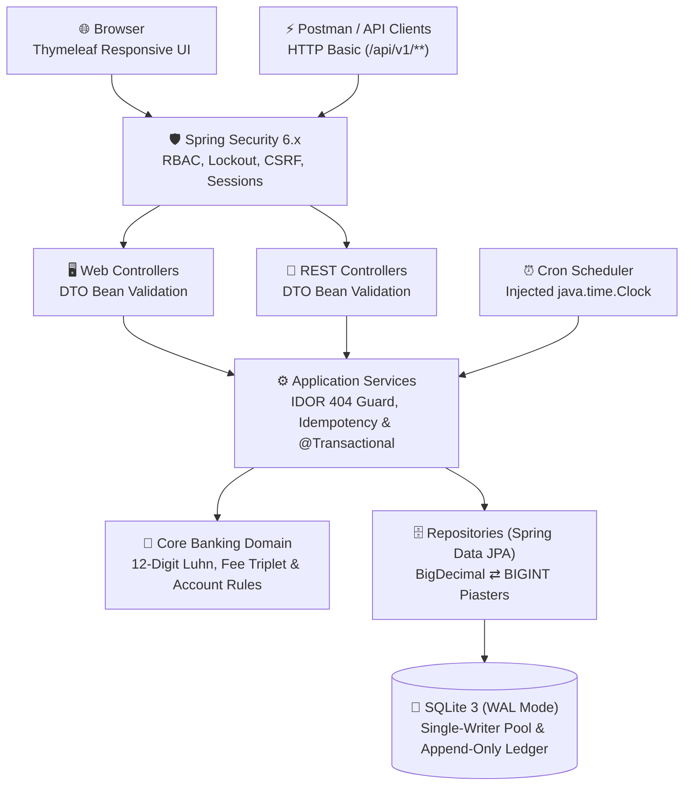
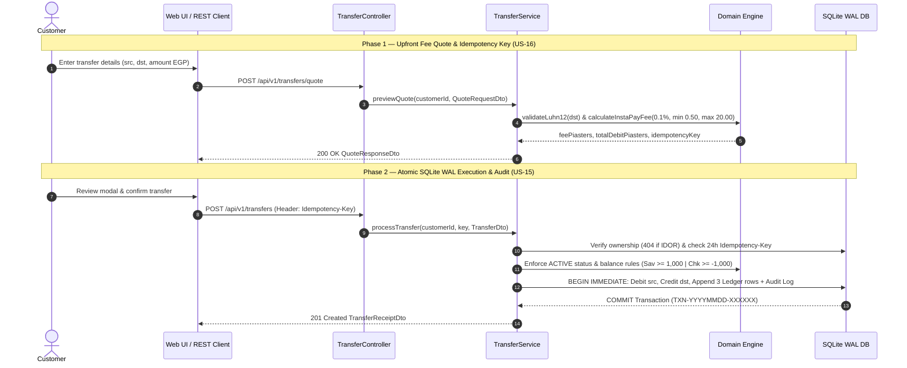
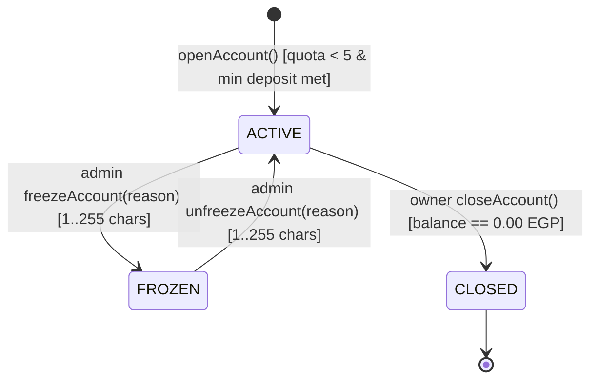
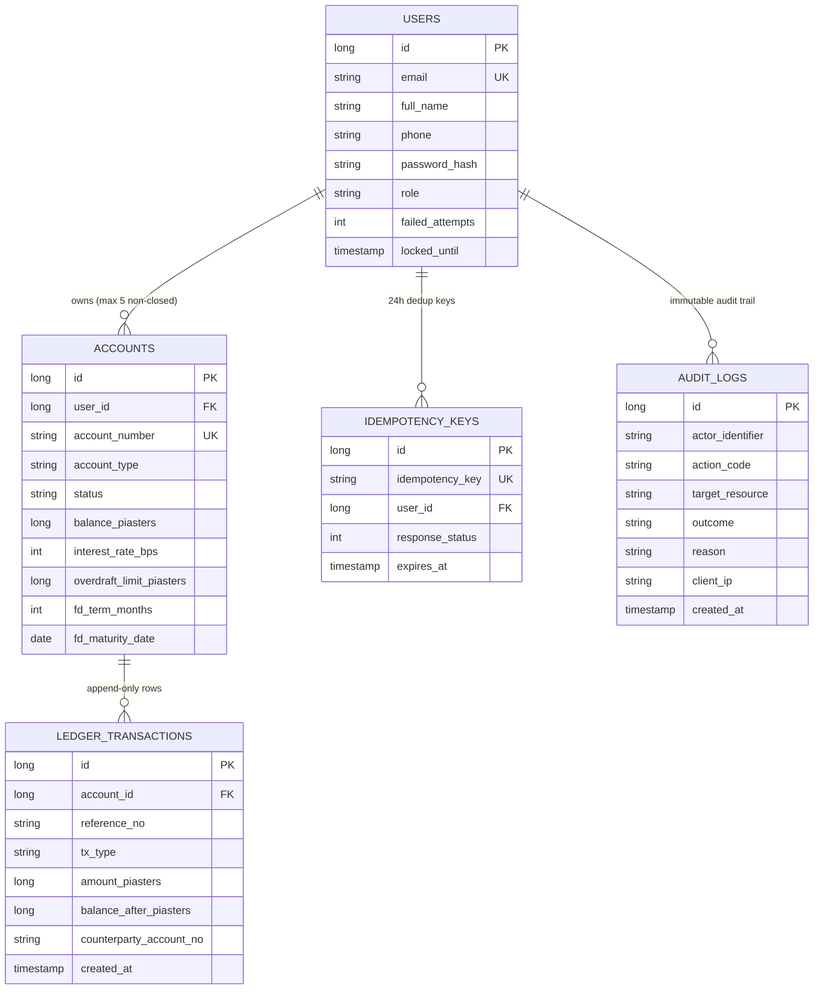

<div align="center">

# 🏦 Banking Transaction System (BTS)

**A web banking application designed to be built, tested and trusted.**

Customers open accounts and move money. Administrators watch over the bank.<br/>
Every rule is written down, numbered and testable.


[Quick start](#-quick-start) ·
[Status](#-project-status) ·
[Architecture](#-architecture) ·
[Business rules](#-business-rules-at-a-glance) ·
[API](#-rest-api) ·
[Testing](#-testing) ·
[Docs](#-documentation) ·
[Team](#-team)

</div>

---

## 📖 Overview

The **Banking Transaction System (BTS)** is the final project of the **DEPI Software Testing** track. It is a real, working web application: customers register, open **Savings**, **Checking** and **Fixed Deposit** accounts, deposit, withdraw and transfer money, while administrators monitor the bank, manage account statuses, and inspect audit logs.

The project is built in Java and **designed for testing from the first line**: every requirement has an ID, every error has a stable code, every page element has a fixed `id`, the demo data is identical on every machine, and time can be controlled in tests via an injected `Clock`.

### ✨ Highlights

|                            |                                                                                                      |
| -------------------------- | ---------------------------------------------------------------------------------------------------- |
| 💰 **Exact money**         | `BigDecimal` in Java, whole piasters (`BIGINT`) in SQLite. No floating-point rounding surprises.     |
| 🔒 **Secure by design**    | BCrypt passwords, role and ownership checks on the server (HTTP 404 on IDOR), CSRF protection.       |
| 📒 **Immutable ledger**    | Every successful operation writes an append-only row. Balances can always be explained.              |
| ⚛️ **All or nothing**      | Each operation runs in one atomic database transaction. It fully succeeds or changes nothing.        |
| 🇪🇬 **Real figures**        | Transfer limits and fees follow InstaPay Egypt; interest rates follow published Egyptian bank rates. |
| 🧪 **Testable everywhere** | Stable element IDs, stable error codes, fixed demo data, an injectable clock, Swagger documentation. |

---

## 🚦 Project status

> Project governance, requirement specifications, system architecture, database & UML modeling, interactive UI/UX prototyping, and the Master Test Plan (69 test cases, Bidirectional RTM, and 14 UAT scenarios) are complete. Core banking modules and automated test suites are actively being executed according to the 8-week plan.

| Area                                                                                   |      Status       |
| -------------------------------------------------------------------------------------- | :---------------: |
| Milestone 1: Project Proposal, Plan, Roles, KPIs & Risk Assessment                     |   ✅ Completed    |
| Milestone 2: Requirement Gathering & System Specification                              |   ✅ Completed    |
| Milestone 3: System Architecture, UML & DB Design, UI Prototype, Test Plan, RTM & UAT  |   ✅ Completed    |
| Registration, login and roles (web and API)                                            |   ⏳ Planned      |
| Open Savings, Checking and Fixed Deposit accounts                                      |   ⏳ Planned      |
| Customer dashboard & profile management                                                |   ⏳ Planned      |
| Deposit and withdraw with per-transaction, daily and monthly limits                    |   ⏳ Planned      |
| Immutable ledger and 12-digit account numbers with Luhn check digit                    |   ⏳ Planned      |
| Access control (HTTP 404 on cross-customer account access)                             |   ⏳ Planned      |
| Close an account (ACTIVE with 0.00 balance)                                            |   ⏳ Planned      |
| Login lockout (5 attempts / 15 min) and session idle timeout                           |   ⏳ Planned      |
| **Transfer, transfer fee triplet, fee quote, idempotency key**                         |   ⏳ Planned      |
| Statements, date/type filters and UTF-8 CSV export                                     |   ⏳ Planned      |
| Admin dashboard, customer/account search, freeze/unfreeze, audit                       |   ⏳ Planned      |
| Scheduled jobs (monthly savings interest, Fixed Deposit maturity)                      |   ⏳ Planned      |
| Selenium 4 UI suite & Postman collection execution                                     |   ⏳ Planned      |

---

## 🚀 Quick start

**You need:** JDK 17+ (JDK 21 LTS recommended) and Maven 3.9 or newer (or use the included Maven Wrapper `./mvnw`).

**1. Clone**

```bash
git clone https://github.com/biscuit-bank/banking-transaction-system.git
cd banking-transaction-system
```

**2. Run the tests**

```bash
mvn test
```

*(Or `./mvnw test` if using the Maven Wrapper).* This runs the unit, integration and API security tests.

**3. Start the application with demo data**

Windows PowerShell (**the quotes are required**):

```powershell
mvn spring-boot:run "-Dspring-boot.run.profiles=dev"
```

macOS, Linux and Git Bash:

```bash
mvn spring-boot:run -Dspring-boot.run.profiles=dev
```

**4. Open** <http://localhost:8080> and log in with a demo user.

|                               |                                                                                                                                      |
| ----------------------------- | ------------------------------------------------------------------------------------------------------------------------------------ |
| Web application               | <http://localhost:8080>                                                                                                              |
| Swagger UI (dev profile only) | <http://localhost:8080/swagger-ui.html>                                                                                              |
| Interactive UI/UX Prototype   | [Google Stitch Live Prototype](https://stitch.withgoogle.com/preview/6808874948880035503?node-id=96ca77e2f2e3497e86aedccbf40da2f5)   |
| Demo users and accounts       | [`docs/seed-data.md`](docs/seed-data.md) (dev profile only, all data is fictional)                                                   |

<details>
<summary><b>🛠️ Troubleshooting</b></summary>

| Problem                                       | Fix                                                                          |
| --------------------------------------------- | ---------------------------------------------------------------------------- |
| `Unknown lifecycle phase ".run.profiles=dev"` | You are in PowerShell. Put the option in quotes, as shown above.             |
| `Port 8080 was already in use`                | Stop the other program, or start with `--server.port=8081`.                  |
| `release version 17 not supported`            | Your JDK is older than 17. Install JDK 17 or newer (JDK 21 LTS recommended). |
| `mvn` is not recognised                       | Use `./mvnw` (`.\mvnw.cmd` on Windows), or run from IntelliJ IDEA.           |
| Something fails on a fresh clone              | Share the first 40 lines of the error with the team before changing code.    |

**Reset the demo data:** stop the application, delete `data/bank.db`, `data/bank.db-wal` and `data/bank.db-shm`, and start again. The demo accounts come back with the same numbers.

**Optional:** run `mvn -N wrapper:wrapper` once and commit the generated `mvnw` files, so nobody needs to install Maven locally.

</details>

---

## 🧩 Features

### Account types

|                         | **Savings**                 | **Checking**                  | **Fixed Deposit**                                          |
| ----------------------- | --------------------------- | ----------------------------- | ---------------------------------------------------------- |
| Purpose                 | Save and earn interest      | Daily spending                | Lock money for a fixed term                                |
| Opening deposit         | at least 1,000.00 EGP       | 0.00 EGP or more              | at least 5,000.00 EGP                                      |
| Minimum balance         | 1,000.00 EGP                | down to −1,000.00 (overdraft) | not applicable                                             |
| Interest                | 17.00% a year, paid monthly | none                          | 17.00% (12 months) or 17.75% (36 months), paid at maturity |
| Deposit later           | yes                         | yes                           | no                                                         |
| Withdraw / transfer out | keeping the minimum balance | down to the overdraft limit   | only on or after maturity, full balance only               |

### Money operations

- **Core Transactions:** Deposits, withdrawals, own-account transfers (0.00 EGP fee), and inter-customer transfers (with dynamic fee calculation and upfront fee quote).
- **Velocity Limits:** Enforced per transaction, per calendar day, and per calendar month.
- **Atomicity & Error Handling:** Failed operations return a deterministic error code (`Part 6.1` of Requirement Gathering and `Section 3.5` of Milestone 3) and roll back completely leaving all balances unchanged.

### Roles

- **Customer:** Manages own profile and accounts, deposits, withdraws, transfers, and views/exports own statements.
- **Admin:** Views bank reserve metrics, searches customers and accounts, freezes/unfreezes accounts with audit reasons, triggers monthly interest jobs, and views the audit log. An admin cannot move money or read passwords (`ADM-07`, `US-25`).

---

## 🏗️ Architecture

### Layered Modular Monolith Flow



| Layer        | Rule                                                          |
| ------------ | ------------------------------------------------------------- |
| Controllers  | Translate HTTP to service calls. **No banking rules here.**   |
| Services     | Use cases, ownership checks, and atomic `@Transactional` boundaries. |
| Domain       | What each account type allows. Plain Java, easy to unit-test. |
| Repositories | Data access only (Spring Data JPA + Piaster converter).       |

### Atomic Inter-Customer Transfer & Upfront Fee Quote Sequence



### Account life cycle



A frozen account refuses every financial operation (`ACCOUNT_FROZEN`). A closed account stays in the system for its history, frees one slot from the 5-account limit, and can never be reopened (`ACCOUNT_CLOSED`).

### Data model



> **Why piasters?** SQLite has no exact decimal type (`REAL` uses floating point). Money is stored as integer whole piasters (`BIGINT`, where `100.25 EGP` is stored as `10025`) and converted to `BigDecimal` (scale 2, `HALF_UP`) in one centralized converter.

---

## 📐 Business rules at a glance

| Rule                               | Value                                                                          |
| ---------------------------------- | ------------------------------------------------------------------------------ |
| Currency                           | EGP, two decimals (more decimals are rejected with `INVALID_AMOUNT`)           |
| Maximum per transaction            | **70,000.00 EGP** (`BR-05`)                                                    |
| Daily outgoing limit per account   | **120,000.00 EGP** (`BR-06`)                                                   |
| Monthly outgoing limit per account | **400,000.00 EGP** (`BR-06`)                                                   |
| Transfer fee (to another customer) | **0.1%**, minimum **0.50 EGP**, maximum **20.00 EGP** (`BR-26`). Free for own accounts (`BR-27`). |
| Savings minimum balance            | **1,000.00 EGP** (`BR-07`)                                                     |
| Checking overdraft                 | Down to **−1,000.00 EGP** (`BR-10`)                                            |
| Fixed Deposit                      | Minimum **5,000.00 EGP** (`BR-11`) · **12 months at 17.00%** · **36 months at 17.75%** (`BR-12`) |
| Open accounts per customer         | Maximum **5** non-closed accounts (`BR-22`)                                    |

<details>
<summary><b>Worked examples</b></summary>

| Situation                                          | Result                                                               |
| -------------------------------------------------- | -------------------------------------------------------------------- |
| Savings balance 1,500.00, withdraw 500.00          | Succeeds, balance 1,000.00                                           |
| Savings balance 1,500.00, withdraw 500.01          | Rejected (`MIN_BALANCE_VIOLATION`): below the 1,000.00 minimum       |
| Checking balance 0.00, withdraw 1,000.00           | Succeeds, balance −1,000.00                                          |
| Transfer 100.00 to another customer                | Fee 0.50 (0.1% is 0.10, so the 0.50 minimum applies)                 |
| Transfer 20,000.00 or 70,000.00                    | Fee 20.00 (capped at the 20.00 maximum)                              |
| Monthly interest on a Savings balance of 12,000.00 | 12,000 × 17% ÷ 12 = 170.00 EGP                                       |
| Fixed Deposit 10,000.00 for 12 months              | Interest 1,700.00 EGP at maturity                                    |
| Fixed Deposit 5,000.00 for 36 months               | Interest 2,662.50 EGP at maturity                                    |

</details>

The transaction limits and transfer fees follow InstaPay Egypt benchmarks. The interest rates follow published Egyptian bank products, and every numerical threshold is externalized in `application.yml`.

---

## 🔌 REST API

Base path `/api/v1` · Authentication: **HTTP Basic** (email and password) · Responses: JSON

**Core Account, Transaction & Administrative Endpoints**

| Method | Path                                                        | Who      | Purpose                                                 |
| ------ | ----------------------------------------------------------- | -------- | ------------------------------------------------------- |
| `POST` | `/auth/register`                                            | Anyone   | Register a customer                                     |
| `POST` | `/auth/login` · `/auth/logout`                              | Anyone   | Authenticate session & rotate session ID / Logout       |
| `GET`  | `/profile` · `PUT /profile`                                 | Customer | View or update personal profile                         |
| `GET`  | `/dashboard`                                                | Customer | Portfolio summary & active account cards                |
| `POST` | `/accounts`                                                 | Customer | Open Savings, Checking, or Fixed Deposit account        |
| `GET`  | `/accounts/{accountNo}`                                     | Owner    | Account product details (returns 404 on IDOR)           |
| `POST` | `/accounts/{accountNo}/close`                               | Owner    | Close an ACTIVE account (balance must be 0.00 EGP)      |
| `POST` | `/transactions/deposit`                                     | Owner    | Deposit funds (`Idempotency-Key` supported)             |
| `POST` | `/transactions/withdraw`                                    | Owner    | Withdraw funds (`Idempotency-Key` supported)            |
| `POST` | `/transfers/quote`                                          | Owner    | Preview upfront InstaPay fee quote & `Idempotency-Key`  |
| `POST` | `/transfers`                                                | Owner    | Execute atomic own-account or inter-customer transfer   |
| `GET`  | `/accounts/{accountNo}/statements`                          | Owner    | Paginated & filtered statement ledger                   |
| `GET`  | `/accounts/{accountNo}/statements/export`                   | Owner    | Download formula-sanitized UTF-8 CSV statement          |
| `GET`  | `/admin/dashboard` · `/admin/customers` · `/admin/accounts` | Admin    | Reserve metrics & directory search                      |
| `POST` | `/admin/accounts/{accountNo}/freeze` · `/unfreeze`          | Admin    | Freeze / unfreeze account with mandatory reason         |
| `POST` | `/admin/jobs/monthly-interest`                              | Admin    | Trigger idempotent monthly interest & FD maturity job   |
| `GET`  | `/admin/audit-logs`                                         | Admin    | Query newest-first immutable security & financial audit |

Full endpoint schemas and error contracts are documented in [`milestone-2/requirement-gathering.pdf`](milestone-2/requirement-gathering.pdf) and [`milestone-3/system-design-and-test-plan.pdf`](milestone-3/system-design-and-test-plan.pdf).

Every error response follows a standardized JSON structure so automated tests can assert on the `error` / `errorCode`:

```json
{
	"timestamp": "2026-10-26T10:15:30Z",
	"status": 422,
	"error": "MIN_BALANCE_VIOLATION",
	"message": "Savings account balance cannot fall below the 1,000.00 EGP minimum.",
	"path": "/api/v1/transactions/withdraw",
	"details": []
}
```

|   HTTP    | Meaning                                                                                                                            |
| :-------: | ---------------------------------------------------------------------------------------------------------------------------------- |
|    400    | Invalid input (`INVALID_AMOUNT`, `INVALID_ACCOUNT_NUMBER`, `SAME_ACCOUNT_TRANSFER`, `INVALID_SEARCH_QUERY`)                        |
| 401 / 403 | Unauthenticated / Unauthorized role (`ACCOUNT_LOCKED`, `ADMIN` attempting money operations)                                        |
|    404    | Account not found, **or belongs to another customer** (`ACCOUNT_NOT_FOUND` — SEC-02 IDOR protection)                               |
|    409    | Duplicate email or idempotency conflict (`DUPLICATE_EMAIL`, `IDEMPOTENCY_CONFLICT`)                                                |
| 422 / 423 | Business rule or state violation (`MIN_BALANCE_VIOLATION`, `OVERDRAFT_LIMIT_EXCEEDED`, `TXN_LIMIT_EXCEEDED`, `ACCOUNT_FROZEN`)     |
|    429    | Rate limit threshold exceeded (`RATE_LIMIT_EXCEEDED`)                                                                              |

Try the API with Postman or Swagger UI. (In PowerShell, `curl` is an alias; use `curl.exe` for the command line.)

---

## 🧪 Testing

The system is engineered to be verified across all testing levels, with dedicated separation between **Functional QA** (led by the QA Lead) and **Application Security Testing** (led by the Tech Lead & AppSec Engineer). The complete **Master Test Plan (69 test cases, 13 integration scenarios, Bidirectional RTM, and 14 UAT scenarios)** is documented in [`milestone-3/system-design-and-test-plan.pdf`](milestone-3/system-design-and-test-plan.pdf):

| Level                                                                  | Tools & Techniques                                    | Owner                   | State |
| ---------------------------------------------------------------------- | ----------------------------------------------------- | ----------------------- | :---: |
| Master Test Plan (69 TCs), Bidirectional RTM & 14 UAT Scenarios        | EP, BVA, Decision Tables, State Transition            | QA Lead & Tech Lead     |  ✅   |
| Static testing (requirements & peer-review checklists)                 | GitHub PRs, Jira, RTM                                 | QA Lead & Tech Lead     |  ✅   |
| Unit tests (domain account rules, converters, Luhn IDs >= 90% JaCoCo)  | JUnit 5, JaCoCo, Clock Mocking                        | Core Logic & Tech Lead  |  🔄   |
| Integration tests (SQLite WAL, limits, parallel concurrency IT-01..13) | Spring Boot Test, JUnit 5                             | Tech Lead & QA Lead     |  🔄   |
| **Application Security & OWASP Top 10 Suite (RBAC, IDOR 404, CSRF)**   | **Spring MockMvc, OWASP Dependency-Check, SonarLint** | **Tech Lead & AppSec**  |  🔄   |
| Functional UI automation (using frozen HTML element IDs)               | Selenium 4 WebDriver (Page Object Model)              | QA Lead                 |  ⏳   |
| Functional API collection & P95 latency assertions (< 500 ms)          | Postman & Newman                                      | QA Lead                 |  ⏳   |

```bash
mvn test
```

- Tests never touch `data/bank.db`; each test context uses an isolated database under `target/`.
- Every test case traces bidirectionally to User Stories (`US-01` to `US-25`), Requirement IDs (`AUTH`, `CUS`, `ACC`, `TXN`, `STM`, `ADM`, `JOB`, `AUD`, `NFR`, `SEC`), and Business Rules (`BR-01` to `BR-29`).

---

## 🔐 Security

All application security architecture, audit logging (`AUD`), and vulnerability verification (`SEC-01` to `SEC-11`) are engineered and tested by the **Tech Lead & AppSec Engineer**:

- **Passwords (`AUTH-05`, `SEC-03`):** Salted BCrypt hashing (cost factor >= 10); 8 to 64 characters requiring uppercase, lowercase, and a digit; 5-attempt / 15-minute login lockout (`AUTH-06`, `US-02`).
- **Access Control & IDOR (`SEC-01`, `SEC-02`, `US-04`):** Deny by default; role and ownership checks enforced on the server. Requesting another customer's account returns **HTTP 404 (`ACCOUNT_NOT_FOUND`)**—never 403—so account existence cannot be enumerated.
- **CSRF (`SEC-05`):** Synchronizer tokens on every state-changing web form. The stateless REST API uses HTTP Basic.
- **Sessions (`AUTH-07`, `SEC-06`, `US-03`):** Session ID rotation on login; 15 minutes of inactivity auto-expiry; cookies configured with `HttpOnly`, `SameSite=Lax`, and `Secure`.
- **Secrets (`SEC-08`, `US-25`):** Zero secrets or database files in Git (`.env` and `*.db` excluded via `.gitignore`); bootstrap credentials injected via environment variables.
- **Swagger (`SEC-08`):** Disabled (or restricted to Admin) outside the `dev` profile.

---

## ⚙️ Configuration

All business parameters live in [`application.yml`](src/main/resources/application.yml). Adjusting a limit, fee, or interest rate never requires modifying Java code.

| Setting                                                       | Purpose                                                                                                  |
| ------------------------------------------------------------- | -------------------------------------------------------------------------------------------------------- |
| `bank.limits.*`                                               | Per-transaction (`70,000`), daily (`120,000`) and monthly (`400,000`) limits                             |
| `bank.fee.*`                                                  | Transfer fee rate (`0.1%`), minimum (`0.50 EGP`) and maximum (`20.00 EGP`)                               |
| `bank.savings.*` · `bank.checking.*` · `bank.fixed-deposit.*` | Interest rates, minimum balances, overdraft limit, and lock-in terms                                     |
| `bank.admin.email` · `bank.admin.password`                    | Initial administrator bootstrap (use `BANK_ADMIN_EMAIL` and `BANK_ADMIN_PASSWORD` environment variables) |
| `spring.datasource.url`                                       | SQLite database path, WAL mode, and busy-timeout settings                                                |

Profiles: **`dev`** (deterministic demo seed data and Swagger UI) and **`test`** (isolated database per test run).

---

## 🗂️ Project structure

```text
banking-transaction-system/
├── milestone-1/   Project Proposal, Plan, Roles Matrix, KPIs, and Risk Assessment PDFs
├── milestone-2/   Requirement Gathering Specification PDF (Stakeholders, Stories, FRs, NFRs, Rules)
├── milestone-3/   Master System Design, UML & DB Models, Architecture, UI Prototype, Test Plan, RTM & UAT PDF
├── src/main/java/com/depi/bank/
│   ├── domain/        entities, account hierarchy rules, money helpers, piaster converters
│   ├── exception/     BankException and standardized ErrorCode enum
│   ├── service/       transactional use cases: auth, accounts, deposits, withdrawals, transfers, audit
│   ├── repository/    Spring Data JPA repositories
│   ├── api/           REST controllers, DTOs, centralized exception handler
│   ├── web/           Thymeleaf page controllers
│   └── config/        Spring Security, injectable Clock, configuration properties, seed loader
├── src/main/resources/
│   ├── application.yml, application-dev.yml
│   ├── templates/     Thymeleaf pages (with permanent HTML element IDs for Selenium)
│   └── static/css/
├── src/test/java/     JUnit 5 unit, concurrency, integration, and MockMvc security tests
└── data/              SQLite database file (created at runtime, ignored by Git)
```

---

## 📚 Documentation

All project management and engineering specification documents are self-contained and organized by milestone:

| Milestone       | Document Category              | Document Title                                                                        | Location / File                                                                                                                              |
| :-------------: | :----------------------------- | :------------------------------------------------------------------------------------ | :------------------------------------------------------------------------------------------------------------------------------------------- |
| **Milestone 1** | Project Management             | Project Proposal                                                                      | [`milestone-1/project-proposal.pdf`](milestone-1/project-proposal.pdf)                                                                       |
| **Milestone 1** | Project Management             | Project Plan                                                                          | [`milestone-1/project-plan.pdf`](milestone-1/project-plan.pdf)                                                                               |
| **Milestone 1** | Project Management             | Task Assignment & Peer-Review Matrix                                                  | [`milestone-1/task-assignment-and-roles.pdf`](milestone-1/task-assignment-and-roles.pdf)                                                     |
| **Milestone 1** | Project Management             | Key Performance Indicators (KPIs)                                                     | [`milestone-1/KPIs.pdf`](milestone-1/KPIs.pdf)                                                                                               |
| **Milestone 1** | Project Management             | Risk Assessment & Mitigation Plan                                                     | [`milestone-1/risk-assessment-and-mitigation-plan.pdf`](milestone-1/risk-assessment-and-mitigation-plan.pdf)                                 |
| **Milestone 2** | Requirements & Specifications  | Requirement Gathering                                                                 | [`milestone-2/requirement-gathering.pdf`](milestone-2/requirement-gathering.pdf)                                                             |
| **Milestone 3** | Architecture, Design, QA & UAT | System Analysis, UML, DB Design, Architecture, API, UI Prototype, Test Plan, RTM & UAT | [`milestone-3/system-design-and-test-plan.pdf`](milestone-3/system-design-and-test-plan.pdf)                                                 |
| **Milestone 3** | Interactive UI/UX Wireframes   | Google Stitch Live Interactive Prototype (Customer & Admin Portals + Modals)          | [Open Live Prototype on Google Stitch](https://stitch.withgoogle.com/preview/6808874948880035503?node-id=96ca77e2f2e3497e86aedccbf40da2f5) |

---

## 👥 Team

|  #  | Name                 | Role                                            | GitHub                                                                                                                                                                                                   |
| :-: | -------------------- | ----------------------------------------------- | -------------------------------------------------------------------------------------------------------------------------------------------------------------------------------------------------------- |
|  1  | **Muhammad Sayyid**  | Tech Lead, Software Architect & AppSec Engineer | [](https://github.com/M07ammadSayed)                                                |
|  2  | **Somia Rashad**     | QA Lead & Test Automation Engineer              | [](https://github.com/SomaiAghaa)                                                         |
|  3  | **Asmaa Mohamed**    | Frontend & UI Engineer                          | [](https://github.com/Asmaa-Mohamed28)                                        |
|  4  | **Aladdin Ahmed**    | Core Banking Logic Engineer                     | [](https://github.com/AlaadinAhmed)                                                   |
|  5  | **Aghapy Antonious** | Backend Services & Admin Engineer               | [](https://github.com/aghapyantoniouswaheeb-dotcom) |

> Full deliverable ownership and cross-functional review obligations are detailed in [`milestone-1/task-assignment-and-roles.pdf`](milestone-1/task-assignment-and-roles.pdf) and the Milestone 3 Master Specification [`milestone-3/system-design-and-test-plan.pdf`](milestone-3/system-design-and-test-plan.pdf).

---

## 🤝 Contributing and Git workflow

```text
main   ← stable, protected
 └── dev   ← integration branch
      ├── feature/<JIRA-KEY>-short-name
      ├── fix/<JIRA-KEY>-short-name
      ├── test/<JIRA-KEY>-short-name
      └── docs/short-name
```

- **No direct push** to `main` or `dev`. Work on a branch and open a Pull Request.
- **Review:** every Pull Request is reviewed according to the Peer-Review Matrix. Changes touching money calculations or security filter chains also require Tech Lead & AppSec sign-off.
- **Commit messages:** `feat:`, `fix:`, `test:`, `docs:`, `refactor:` or `chore:`, followed by a concise summary.
- **Definition of Done:** reviewed Pull Request, unit/integration/security tests pass, acceptance criteria met, RTM updated, zero open Critical or High defects, documentation synced.

**Rules of the road**

- Money is always `BigDecimal` in Java and whole piasters (`BIGINT`) in SQLite. Never `double` or `float`.
- Zero business calculation rules in controllers or Thymeleaf templates; keep domain logic inside `domain/` and `service/`.
- Do not rename HTML element IDs after the Week 4 UI freeze without coordinating with the QA Lead.
- Never commit `.env` files or SQLite database files (`.db`, `.sqlite`).

---

## 🗺️ Roadmap

| Week | Goal                                                                                           |
| :--: | ---------------------------------------------------------------------------------------------- |
|  1   | Project foundations, governance documents, repository setup, and SQLite WAL architecture spike |
|  2   | Requirement Gathering sign-off, Master Test Plan & RTM, domain classes, registration & auth    |
|  3   | Core banking MVP: accounts, deposits, withdrawals, atomic transfers with fees, REST APIs       |
|  4   | Statements, CSV export, admin dashboard, audit log, scheduled jobs, and UI element ID freeze   |
|  5   | Selenium 4 UI suite, Postman API collection, and MockMvc/OWASP security test execution         |
|  6   | Static security analysis (SonarLint/SpotBugs), OWASP dependency scan, bug fixing, regression   |
|  7   | OpenAPI/Swagger verification, Jira test reports, JaCoCo coverage analysis, and demo rehearsals |
|  8   | Buffer week, backup demo recording, and final project presentation & defense                   |

---

## ⚠️ Known limitations

- **Spring Boot 3.5** reached the end of free commercial security updates in June 2026 (`Risk R-10`). This is accepted for a local offline demonstration; an OWASP Dependency-Check scan is scheduled prior to delivery, and the production upgrade path to Spring Boot 4.1 is documented.
- **SQLite** permits a single concurrent writer and lacks a native exact decimal type (`Risk R-05`). Both are mitigated architecturally: money is stored as integer piasters (`BIGINT`), and the connection pool uses WAL mode with immediate transaction locking.
- Deposits simulate cash counter deposits (`TXN-01`) and all seed data is strictly fictional.
- The application is designed for local execution and demonstration, not public internet exposure.

---

## 📄 License

Released under the **MIT License**. See the [LICENSE](LICENSE) file.

Third-party libraries (Spring Boot, Hibernate, SQLite JDBC, Thymeleaf, springdoc and others) retain their respective licenses.

<div align="center">

Built with care for the **DEPI Software Testing** final project.

</div>