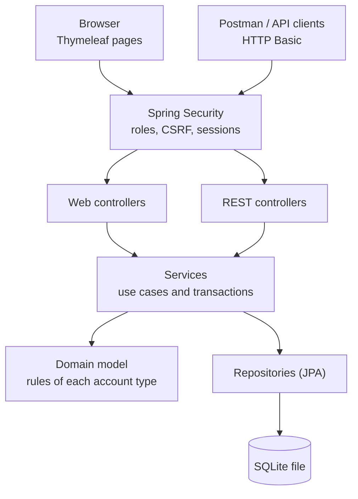
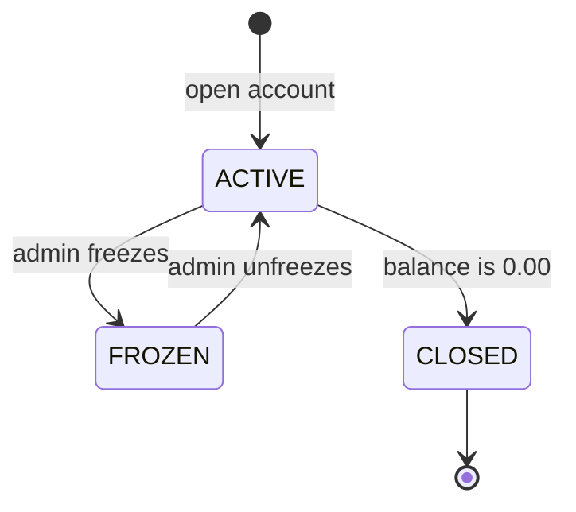
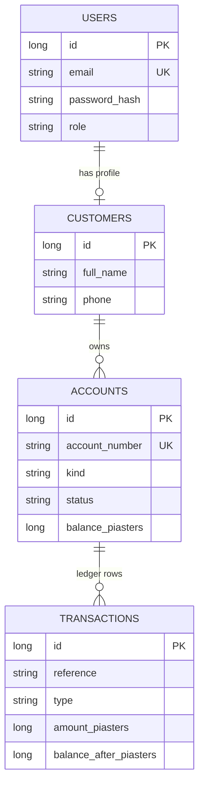

<div align="center">

# 🏦 Banking Transaction System

**A web banking application designed to be built, tested and trusted.**

Customers open accounts and move money. Administrators watch over the bank.
Every rule is written down, numbered and testable.


[Quick start](#-quick-start) ·
[Status](#-project-status) ·
[Architecture](#-architecture) ·
[Business rules](#-business-rules-at-a-glance) ·
[API](#-rest-api) ·
[Testing](#-testing) ·
[Docs](#-documentation) ·
[Team](#-team)

</div>

---

## 📖 Overview

The **Banking Transaction System** is the final project of the **DEPI Software Testing** track. It is a real, working web application: customers register, open **Savings**, **Checking** and **Fixed Deposit** accounts, deposit, withdraw and (soon) transfer money, while administrators monitor the bank.

The project is built in Java and **designed for testing from the first line**: every requirement has an ID, every error has a stable code, every page element has a fixed `id`, the demo data is identical on every machine, and time can be controlled in tests.

### ✨ Highlights

|                            |                                                                                                      |
| -------------------------- | ---------------------------------------------------------------------------------------------------- |
| 💰 **Exact money**         | `BigDecimal` in Java, whole piasters in the database. No rounding surprises.                         |
| 🔒 **Secure by design**    | BCrypt passwords, role and ownership checks on the server, CSRF protection, escaped output.          |
| 📒 **Immutable ledger**    | Every successful operation writes an append-only row. Balances can always be explained.              |
| ⚛️ **All or nothing**      | Each operation runs in one database transaction. It fully succeeds or changes nothing.               |
| 🇪🇬 **Real figures**        | Transfer limits and fees follow InstaPay Egypt; interest rates follow published Egyptian bank rates. |
| 🧪 **Testable everywhere** | Stable element ids, stable error codes, fixed demo data, an injectable clock, Swagger documentation. |

---

## 🚦 Project status

> The foundation is built. Several modules are still being developed by the team.

| Area                                                                |   Status   |
| ------------------------------------------------------------------- | :--------: |
| Registration, login and roles (web and API)                         | ⏳ Planned |
| Open Savings, Checking and Fixed Deposit accounts                   | ⏳ Planned |
| Customer dashboard                                                  | ⏳ Planned |
| Deposit and withdraw with per-transaction, daily and monthly limits | ⏳ Planned |
| Immutable ledger and 12-digit account numbers with check digit      | ⏳ Planned |
| Access control (no access to another customer's account)            | ⏳ Planned |
| Close an account (API)                                              | ⏳ Planned |
| Login lockout and session timeout                                   | ⏳ Planned |
| **Transfer, transfer fee, fee quote, idempotency key**              | ⏳ Planned |
| Customer profile page                                               | ⏳ Planned |
| Statements, filters and CSV export                                  | ⏳ Planned |
| Admin dashboard, search, freeze / unfreeze, audit log               | ⏳ Planned |
| Scheduled jobs (monthly interest, Fixed Deposit maturity)           | ⏳ Planned |
| Selenium UI suite, Postman collection, manual test plan             | ⏳ Planned |

<!-- The complete list of requirements, with priorities, is in the [specification](docs/specification/Banking_System_Requirements_v2_6.docx). -->

---

## 🚀 Quick start

**You need:** JDK 17 or newer and Maven 3.9 or newer (IntelliJ IDEA includes Maven).

**1. Clone**

```bash
git clone https://github.com/biscuit-bank/banking-transaction-system.git
cd banking-transaction-system
```

**2. Run the tests**

```bash
mvn test
```

This runs the unit, integration and API security tests.

**3. Start the application with demo data**

Windows PowerShell (**the quotes are required**):

```powershell
mvn spring-boot:run "-Dspring-boot.run.profiles=dev"
```

macOS, Linux and Git Bash:

```bash
mvn spring-boot:run -Dspring-boot.run.profiles=dev
```

**4. Open** <http://localhost:8080> and log in with a demo user.

|                               |                                                                                    |
| ----------------------------- | ---------------------------------------------------------------------------------- |
| Web application               | <http://localhost:8080>                                                            |
| Swagger UI (dev profile only) | <http://localhost:8080/swagger-ui.html>                                            |
| Demo users and accounts       | [`docs/seed-data.md`](docs/seed-data.md) (dev profile only, all data is fictional) |

<details>
<summary><b>🛠️ Troubleshooting</b></summary>

| Problem                                       | Fix                                                                        |
| --------------------------------------------- | -------------------------------------------------------------------------- |
| `Unknown lifecycle phase ".run.profiles=dev"` | You are in PowerShell. Put the option in quotes, as shown above.           |
| `Port 8080 was already in use`                | Stop the other program, or start with `--server.port=8081`.                |
| `release version 17 not supported`            | Your JDK is older than 17. Install JDK 17 or newer.                        |
| `mvn` is not recognised                       | Install Maven, or open the project in IntelliJ IDEA and run it from there. |
| Something fails on a fresh clone              | Share the first 40 lines of the error with the team before changing code.  |

**Reset the demo data:** stop the application, delete `data/bank.db`, `data/bank.db-wal` and `data/bank.db-shm`, and start again. The demo accounts come back with the same numbers.

**Optional:** run `mvn -N wrapper:wrapper` once and commit the generated `mvnw` files, so nobody needs to install Maven.

</details>

---

## 🧩 Features

### Account types

|                         | **Savings**                 | **Checking**                  | **Fixed Deposit**                                          |
| ----------------------- | --------------------------- | ----------------------------- | ---------------------------------------------------------- |
| Purpose                 | Save and earn interest      | Daily spending                | Lock money for a term                                      |
| Opening deposit         | at least 1,000.00           | 0.00 or more                  | at least 5,000.00                                          |
| Minimum balance         | 1,000.00                    | down to −1,000.00 (overdraft) | not applicable                                             |
| Interest                | 17.00% a year, paid monthly | none                          | 17.00% (12 months) or 17.75% (36 months), paid at maturity |
| Deposit later           | yes                         | yes                           | no                                                         |
| Withdraw / transfer out | keeping the minimum balance | down to the overdraft limit   | only after maturity, full balance                          |

### Money operations

- **Deposit** and **withdraw** are available now. **Transfer** (with a fee) is planned.
- Limits are checked per transaction, per day and per month.
- Failed operations return a precise error code and change nothing.

### Roles

- **Customer:** manages own profile and accounts, deposits, withdraws, transfers, views own statements.
- **Admin:** dashboard, search, freeze / unfreeze, audit log. An admin cannot move money or read passwords.

---

## 🏗️ Architecture



| Layer        | Rule                                                          |
| ------------ | ------------------------------------------------------------- |
| Controllers  | Translate HTTP to service calls. **No banking rules here.**   |
| Services     | Use cases and database transactions.                          |
| Domain       | What each account type allows. Plain Java, easy to unit-test. |
| Repositories | Data access only.                                             |

### Account life cycle



A frozen account refuses every operation. A closed account stays in the system for its history and can never be reopened.

### Data model



> **Why piasters?** SQLite has no exact decimal type. Money is stored as whole piasters (100.25 EGP is stored as `10025`) and converted to `BigDecimal` in one place.

---

## 📐 Business rules at a glance

| Rule                               | Value                                                                          |
| ---------------------------------- | ------------------------------------------------------------------------------ |
| Currency                           | EGP, two decimals (more decimals are rejected, never rounded)                  |
| Maximum per transaction            | **70,000.00**                                                                  |
| Daily outgoing limit per account   | **120,000.00**                                                                 |
| Monthly outgoing limit per account | **400,000.00**                                                                 |
| Transfer fee (to another customer) | **0.1%**, minimum 0.50, maximum 20.00. None between a customer's own accounts. |
| Savings minimum balance            | 1,000.00                                                                       |
| Checking overdraft                 | 1,000.00                                                                       |
| Fixed Deposit                      | minimum 5,000.00 · 12 months at 17.00% · 36 months at 17.75%                   |
| Open accounts per customer         | 5                                                                              |

<details>
<summary><b>Worked examples</b></summary>

| Situation                                          | Result                                       |
| -------------------------------------------------- | -------------------------------------------- |
| Savings balance 1,500.00, withdraw 500.00          | Succeeds, balance 1,000.00                   |
| Savings balance 1,500.00, withdraw 500.01          | Rejected: below the minimum balance          |
| Checking balance 0.00, withdraw 1,000.00           | Succeeds, balance −1,000.00                  |
| Transfer 100.00 to another customer                | Fee 0.50 (0.1% is 0.10, the minimum applies) |
| Transfer 20,000.00 or 70,000.00                    | Fee 20.00 (the maximum)                      |
| Monthly interest on a Savings balance of 12,000.00 | 12,000 × 17% ÷ 12 = 170.00                   |
| Fixed Deposit 10,000.00 for 12 months              | Interest 1,700.00 at maturity                |
| Fixed Deposit 5,000.00 for 36 months               | Interest 2,662.50 at maturity                |

</details>

The limits and the fee follow InstaPay Egypt (checked in October 2026). The interest rates are demo values chosen to match published 2026 Egyptian bank products, and they can change, so every number is a configuration value.

---

## 🔌 REST API

Base path `/api/v1` · Authentication: **HTTP Basic** (email and password) · Responses: JSON

**Available now**

| Method | Path                             | Who      | Purpose                                 |
| ------ | -------------------------------- | -------- | --------------------------------------- |
| `POST` | `/auth/register`                 | Anyone   | Register a customer                     |
| `GET`  | `/accounts`                      | Customer | List own accounts                       |
| `POST` | `/accounts`                      | Customer | Open an account                         |
| `GET`  | `/accounts/{number}`             | Owner    | Account details                         |
| `POST` | `/accounts/{number}/close`       | Owner    | Close an account (balance must be 0.00) |
| `POST` | `/accounts/{number}/deposits`    | Owner    | Deposit                                 |
| `POST` | `/accounts/{number}/withdrawals` | Owner    | Withdraw                                |

**Planned:** transfers and fee quote, statements and CSV export, profile, and the `/admin/**` endpoints. See the specification, Section 7.5.

Every error has the same shape, so tools and tests can rely on the `error` code:

```json
{
	"timestamp": "2026-10-10T10:15:30Z",
	"status": 422,
	"error": "INSUFFICIENT_FUNDS",
	"message": "The balance is not enough for this withdrawal.",
	"path": "/api/v1/accounts/100000000032/withdrawals",
	"details": []
}
```

|   HTTP    | Meaning                                                                                                             |
| :-------: | ------------------------------------------------------------------------------------------------------------------- |
|    400    | Invalid input (`VALIDATION_FAILED`, `INVALID_AMOUNT`)                                                               |
| 401 / 403 | Not logged in / not allowed                                                                                         |
|    404    | Account not found, **or not yours**                                                                                 |
|    409    | Email already registered                                                                                            |
|    422    | A business rule was broken (`INSUFFICIENT_FUNDS`, `LIMIT_EXCEEDED`, `MIN_BALANCE_VIOLATION`, `ACCOUNT_FROZEN`, ...) |

Try the API with Postman or Swagger UI. (In PowerShell, `curl` is an alias; use `curl.exe` for the command line.)

---

## 🧪 Testing

The system is built to be tested at every level.

| Level                                                   | Tools                        | State |
| ------------------------------------------------------- | ---------------------------- | :---: |
| Static testing (requirements and code review)           | Jira, pull-request checklist |  ⏳   |
| Unit tests (account rules, converters, account numbers) | JUnit 5                      |  ⏳   |
| Integration tests (database, limits, parallel requests) | Spring Boot Test             |  ⏳   |
| API and security tests (access control, error codes)    | MockMvc                      |  ⏳   |
| UI automation                                           | Selenium 4                   |  ⏳   |
| API collection                                          | Postman                      |  ⏳   |
| Manual test plan and test cases                         | From the specification       |  ⏳   |

```bash
mvn test
```

- Tests never touch `data/bank.db`; each test context uses its own database file under `target/`.
      <!-- - Every test case names the requirement it checks (for example `TC-S-01` checks `SEC-02`). The specification, Section 8, lists ready-made boundary cases. -->
- Test design techniques: equivalence partitioning, boundary value analysis, decision tables, state transition and use-case testing.

---

## 🔐 Security

- **Passwords:** BCrypt, 8 to 64 characters with upper-case, lower-case and a digit.
- **Access control:** deny by default; role and ownership checks on the server. Someone else's account looks exactly like a missing account (HTTP 404), so account numbers cannot be probed.
- **CSRF:** tokens on every web form. The stateless API uses HTTP Basic and no cookies.
- **Sessions:** 15 minutes of inactivity; cookies are `HttpOnly` and `SameSite=Lax`.
- **Secrets:** nothing sensitive in Git. `.env` and database files are ignored; credentials come from environment variables.
- **Swagger** is disabled outside the dev profile.

<!-- The full list (SEC-01 to SEC-11) is in the specification, Section 6. -->

---

## ⚙️ Configuration

All business numbers live in [`application.yml`](src/main/resources/application.yml). Changing a limit or a rate never needs a code change.

| Setting                                                       | Purpose                                                                                                        |
| ------------------------------------------------------------- | -------------------------------------------------------------------------------------------------------------- |
| `bank.limits.*`                                               | Per-transaction, daily and monthly limits                                                                      |
| `bank.fee.*`                                                  | Transfer fee rate, minimum and maximum                                                                         |
| `bank.savings.*` · `bank.checking.*` · `bank.fixed-deposit.*` | Rates, minimum balance, overdraft, terms                                                                       |
| `bank.admin.email` · `bank.admin.password`                    | First administrator. In production use the environment variables `BANK_ADMIN_EMAIL` and `BANK_ADMIN_PASSWORD`. |
| `spring.datasource.url`                                       | SQLite file and settings                                                                                       |

Profiles: **`dev`** (demo data and Swagger) and **`test`** (a fresh database file for each test run).

---

## 🗂️ Project structure

```text
src/main/java/com/depi/bank/
├── domain/        entities, account rules, money helpers, converters
├── exception/     BankException and ErrorCode
├── service/       use cases: registration, accounts, deposit and withdraw
├── repository/    Spring Data repositories
├── api/           REST controllers, DTOs, one error handler
├── web/           page controllers
└── config/        security, clock, properties, start-up loaders
src/main/resources/
├── application.yml, application-dev.yml
├── templates/     Thymeleaf pages (every element a test needs has a stable id)
└── static/css/
src/test/java/     unit, integration and API security tests
docs/              specification, risk plan, demo data
data/              SQLite file (created at run time, ignored by Git)
```

---

## 📚 Documentation

| Document Category      | Document Title                    | Location / File                                                                                          |
| :--------------------- | :-------------------------------- | :------------------------------------------------------------------------------------------------------- |
| **Project Management** | Project Proposal                  | [`milestone-1/project-proposal`](milestone-1/project-proposal.pdf)                                       |
| **Project Management** | Project Plan & Milestones         | [`milestone-1/project-plan`](milestone-1/project-plan.pdf)                                               |
| **Project Management** | Task Assignment & Roles (RACI)    | [`milestone-1/task-assignment-and-roles`](milestone-1/task-assignment-and-roles.pdf)                     |
| **Project Management** | Risk Assessment & Mitigation Plan | [`milestone-1/risk-assessment-and-mitigation-plan`](milestone-1/risk-assessment-and-mitigation-plan.pdf) |
| **Project Management** | KPIs & Success Metrics            | [`milestone-1/KPIs`](milestone-1/KPIs.pdf)                                                               |

<!-- Screenshots can be added later, for example:

-->

---

## 👥 Team

|  #  | Name                 | Role                               | GitHub                                                                                                                                                                                                   |
| :-: | -------------------- | ---------------------------------- | -------------------------------------------------------------------------------------------------------------------------------------------------------------------------------------------------------- |
|  1  | **Muhammad Sayyid**  | Tech Lead & Software Architect     | [](https://github.com/M07ammadSayed)                                                |
|  2  | **Somia Rashad**     | QA Lead & Test Automation Engineer | [](https://github.com/SomaiAghaa)                                                         |
|  3  | **Asmaa Mohamed**    | Frontend & UI                      | [](https://github.com/Asmaa-Mohamed28)                                        |
|  4  | **Aladdin Ahmed**    | Core Banking Logic                 | [](https://github.com/AlaadinAhmed)                                                   |
|  5  | **Aghapy Antonious** | Backend Services & Admin           | [](https://github.com/aghapyantoniouswaheeb-dotcom) |

<!-- Every deliverable has a primary owner and a secondary reviewer. The full matrix and the work breakdown are in the [specification](docs/specification/Banking_System_Requirements_v2_6.docx), Section 9.2. -->

---

## 🤝 Contributing and Git workflow

```text
main   ← stable, protected
 └── dev   ← integration branch
      ├── feature/<JIRA-KEY>-short-name
      ├── fix/<JIRA-KEY>-short-name
      ├── test/<JIRA-KEY>-short-name
      └── docs/short-name
```

- **No direct push** to `main` or `dev`. Work on a branch created from `dev` and open a pull request into `dev`.
- **Review:** every pull request has a reviewer named in the peer-review matrix. Changes that touch money or security also go through the Tech Lead.
- **Commit messages:** `feat:`, `fix:`, `test:`, `docs:`, `refactor:` or `chore:`, then a short description.
- **Definition of Done:** reviewed pull request, tests pass, acceptance criteria met, test cases written and executed, no open Critical or High defect, documentation updated.

**Rules of the road**

- Money is always `BigDecimal`. Never `double`.
- No business rules in controllers or templates. Put them in `domain/` or `service/`.
- Do not rename element ids without telling whoever owns the UI tests.
- Never commit `.env` files or database files.

---

## 🗺️ Roadmap

| Week | Goal                                                                          |
| :--: | ----------------------------------------------------------------------------- |
|  1   | Specification signed off, repository and Jira ready, project skeleton running |
|  2   | Master Test Plan and RTM; architecture and database setup                     |
|  3   | Security and authentication module                                            |
|  4   | Core account domain and logic; front-end pages with permanent element IDs     |
|  5   | Postman API test suite; money operations and scheduled jobs complete          |
|  6   | Selenium UI suite; services, admin and CSV export                             |
|  7   | Regression, defect fixing, documentation and demo preparation                 |
|  8   | Final dry run and final presentation                                          |

---

## ⚠️ Known limitations

- **Spring Boot 3.5** no longer receives free updates (since June 2026). That is acceptable for a local demo; a dependency check is planned before the demo, and an upgrade to Spring Boot 4.1 is possible later.
- **SQLite** allows one writer at a time and has no exact decimal type. The design handles both: money in piasters, one connection, immediate transactions.
- Deposits are simulated cash deposits and all money is fictional.
- The application is meant to run locally. It is not designed to be exposed to the internet.

---

## 📄 License

Released under the **MIT License**. See the [LICENSE](LICENSE) file.

Third-party libraries (Spring Boot, Hibernate, SQLite JDBC, Thymeleaf, springdoc and others) keep their own licenses.

<div align="center">

Built with care for the **DEPI Software Testing** final project.

</div>
